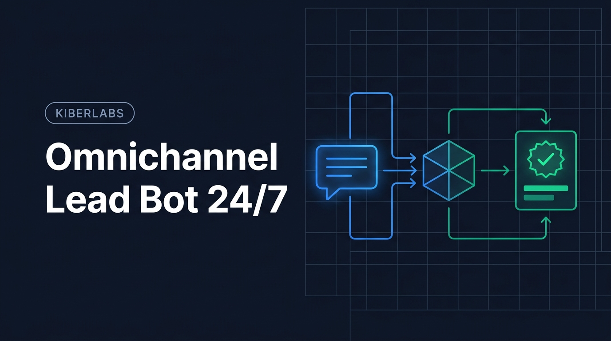
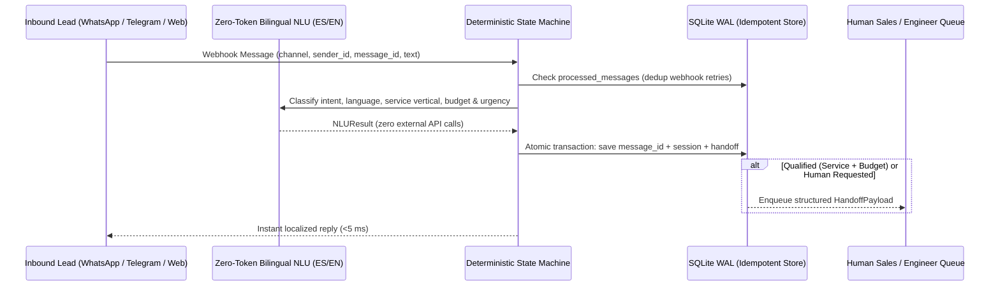

# KiberLabs — 24/7 Omnichannel B2B Lead Qualification Bot

[](https://github.com/Kiberlabs/omnichannel-lead-bot/actions/workflows/ci.yml)



A lightweight, **zero-token bilingual (Spanish & English) lead qualification engine** for WhatsApp Cloud API, Telegram Bots, and B2B Web Widgets.

Built for SMEs and agencies that need instant `<1s` 24/7 lead intake without paying per-message LLM API costs or risking hallucinated pricing promises. Once a lead states their service need and approximate budget (or asks for a human specialist), the state machine atomically enqueues a structured `HandoffPayload` for the sales/engineering team.

---

## Conversation & State Flow



## Key Engineering Highlights

- **Zero-Token Bilingual NLU (`ES` + `EN`):** Deterministic intent, service-category, urgency, spam, and European/US budget parser (`1.200€`, `$1,500`, `650 euros`) with zero external API latency.
- **Webhook Idempotency by Design:** Deduplicates `(channel, message_id)` inside an atomic SQLite transaction so WhatsApp/Telegram webhook retries never trigger double replies or duplicate handoffs.
- **Single-Shot or Multi-Turn Intake:** Automatically skips redundant questions if a prospect provides both project scope and budget in their opening message.
- **Instant Human Escape & Silent Spam Drop:** Escalates immediately when a user asks for a person, and silently drops spam payloads before polluting the CRM queue.

---

## Quickstart

```bash
# 1. Run automated unit & integration tests
python -m pytest -v

# 2. Replay the multi-channel Spanish + English conversation simulation
PYTHONPATH=src python -m lead_bot simulate \
  --script data/demo_conversation.json \
  --db data/leads.db \
  --json
```

---

## Project Layout

```text
omnichannel-lead-bot/
├── data/
│   └── demo_conversation.json    # Multi-channel replay script (ES, EN, duplicate retry & spam)
├── src/lead_bot/
│   ├── models.py                 # Pydantic schemas, LeadState & Intent enums
│   ├── nlu.py                    # Zero-token ES/EN intent & budget extractor
│   ├── storage.py                # Concurrent SQLite WAL session & idempotency store
│   ├── state_machine.py          # Deterministic 24/7 qualification state machine
│   └── cli.py                    # CLI simulator & JSON transcript exporter
└── tests/
    └── test_lead_bot.py          # NLU, idempotency, ES/EN flows, spam & CLI tests
```

---

## License

MIT — Built by **KiberLabs Engineering** (*AI & Python Automation Studio*).
